<div align="center">


<br/>

<a href="#technical-skill-matrix"></a>
<a href="#flagship-systems-technical-deep-dives"></a>
<a href="#complete-project-catalogue"></a>
<a href="#professional-timeline"></a>
<a href="#github-analytics"></a>
<a href="#contact"></a>

<br/><br/>

<a href="https://www.linkedin.com/in/abdullah-imran-211658230"></a>
<a href="mailto:abdullahmran.001@gmail.com"></a>
<a href="https://github.com/abdullahmran-101"></a>

<br/><br/>


</div>

<br/>

<h1 align="center">"BUILD SYSTEMS THAT SURVIVE CONTACT WITH REALITY."</h1>

<br/>

---

## System Boot: Profile Initialisation

```text
abdullah@lahore:~$ ./boot_profile.sh

[  OK  ] Loading identity .............. Abdullah Imran, AI/ML Engineer
[  OK  ] Mounting education ............ B.S. Data Science, UMT Lahore (GPA 3.76/4.00)
[  OK  ] Starting perception modules ... vision | speech | text
[  OK  ] Linking knowledge stores ...... FAISS | ChromaDB | SQLite | Postgres
[  OK  ] Attaching reasoning engines ... LLaMA 3.3 70B | Gemini | GPT | Grok
[  OK  ] Spawning agents ............... ReAct loops | multi-provider routing
[  OK  ] Exposing services ............. FastAPI | Django | Celery | n8n
[  OK  ] Containerising ................ Docker
[ WARN ] Notebook-only demos ........... disabled by policy
[  OK  ] Profile ready ................. type a command below

abdullah@lahore:~$ _
```

### Command Palette

Click a command to jump to that section.

| Command | Output |
|---|---|
| [`cat skills.md`](#technical-skill-matrix) | Full technical skill matrix by layer |
| [`ls ./systems`](#flagship-systems-technical-deep-dives) | Architecture deep dives of flagship projects |
| [`ls ./projects --all`](#complete-project-catalogue) | All 12 shipped projects with stacks |
| [`git log --career`](#professional-timeline) | Experience timeline and roles |
| [`./charts --render`](#capability-charts) | Proficiency and portfolio charts |
| [`tail -f ./active`](#active-development) | What I am building right now |
| [`cat certs.txt`](#education-and-certifications) | Education and certifications |
| [`./contact --now`](#contact) | Email, phone, LinkedIn |

### Choose Your Path

| If you are... | Start here | You will find |
|---|---|---|
| **Hiring** | [Experience](#professional-timeline) then [Skills](#technical-skill-matrix) | Roles, measurable results, stack depth |
| **Looking for a build partner** | [Systems](#flagship-systems-technical-deep-dives) then [Engagement Models](#engagement-models) | Architectures, delivery approach, scope options |
| **An engineer or collaborator** | [Implementation Patterns](#implementation-patterns) then [Projects](#complete-project-catalogue) | Code patterns and repositories |

---

## Profile Panels

Expand any panel.

<details open>
<summary><b>[ 01 ] IDENTITY</b></summary>

<br/>

| | |
|---|---|
| **Name** | Abdullah Imran |
| **Role** | AI/ML Engineer (Freelance, Remote) |
| **Specialisation** | Generative AI, Agentic AI, Backend and Intelligent Systems |
| **Education** | B.S. Data Science, UMT Lahore, 2022 to 2026 (GPA 3.76 / 4.00, Dean's Merit Award x4) |
| **Core domains** | LLM applications, RAG, multimodal fusion, computer vision, workflow automation, MLOps, IoT |
| **Base** | Lahore, Pakistan (remote-first) |

</details>

<details>
<summary><b>[ 02 ] WHAT I BUILD</b></summary>

<br/>

I design, build and deploy **end-to-end intelligent systems**: the model, the retrieval layer, the agent logic, the backend API and the container it ships in.

- **Multimodal assistants** that fuse text, voice, face and posture into one reasoning pipeline
- **Retrieval-grounded LLM systems** with reranking and citation enforcement
- **Multi-agent platforms** with provider routing, persistent memory and inspectable traces
- **Computer vision products** for proctoring, fall detection and threat analysis
- **Automation workflows** in n8n with LLM decision steps, retries and error alerting

</details>

<details>
<summary><b>[ 03 ] HOW I WORK</b></summary>

<br/>

```python
class AbdullahImran:
    role      = "AI/ML Engineer"
    paradigms = ["agentic", "multimodal", "retrieval-grounded"]
    languages = ["Python", "SQL", "JavaScript"]
    ships     = ["FastAPI services", "Dockerised pipelines", "n8n automations"]
    principle = "Grounded outputs. Observable agents. Deployable by default."

    def solve(self, problem):
        signal   = self.perceive(problem)        # CV, speech, text, sensors
        context  = self.retrieve(signal)         # FAISS / ChromaDB + reranking
        decision = self.reason(signal, context)  # LLM + policy gates
        return self.deploy(decision)             # API, container, monitoring
```

</details>

<details>
<summary><b>[ 04 ] NOW ACTIVE</b></summary>

<br/>

| Project | State |
|---|---|
| Hospital Procurement Intelligence Platform | V2 complete (forecasting and supplier scoring), V3 in planning |
| AI Coding Assistant | VS Code extension with FastAPI multi-LLM router, Phase 2 of 10 complete |
| Lahori | Lahore food discovery platform |

</details>

<details>
<summary><b>[ 05 ] ASK ME ABOUT</b></summary>

<br/>

`RAG design and reranking` | `multimodal fusion` | `agent routing and failover` | `crisis-gated LLM pipelines` | `YOLO and MediaPipe proctoring` | `n8n automation with retries` | `forecasting and supplier scoring` | `taking a prototype to Docker`

</details>

---

## Capability Map

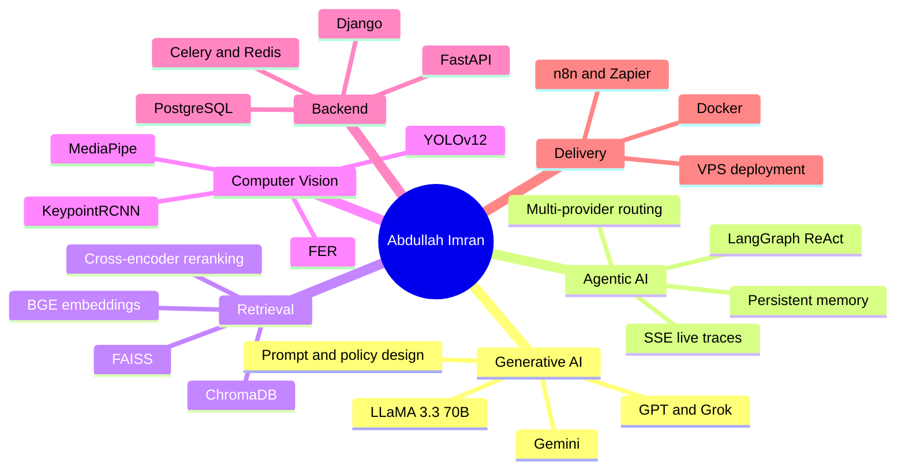

<div align="center">


</div>

---

## Engineering Principles

| Principle | How it shows up in my work |
|---|---|
| **Grounding over fluency** | Retrieval-augmented generation with reranking; citation-enforcement in Research Forge AI so every claim traces to a source |
| **Safety gates before generation** | HealMatrix AI runs crisis detection ahead of the LLM, so high-risk input is escalated rather than improvised on |
| **Observable agents** | AgentFlow AI streams live tool-call traces over SSE, so reasoning is inspectable instead of opaque |
| **Provider independence** | Smart model routing across Groq, Gemini and OpenRouter avoids single-vendor lock-in and rate-limit failure |
| **Multimodal by default** | Face, posture, voice and text are fused as signals, not treated as separate demos |
| **Resilient automation** | n8n workflows ship with retry logic on HTTP nodes and a dedicated error-notifier workflow with email alerts |
| **Incremental delivery** | Complex platforms are built in progressively harder versions, each one working end to end |

---

## Technical Skill Matrix

| Layer | Technologies |
|---|---|
| **Languages** | Python, SQL, JavaScript |
| **LLM and GenAI** | Groq (LLaMA 3.3 70B), Google Gemini, OpenAI, Grok (xAI), OpenRouter, prompt and policy design, structured outputs |
| **Agents and orchestration** | LangGraph (ReAct agents), multi-agent routing, tool calling, persistent agent memory, n8n, Zapier |
| **Retrieval (RAG)** | FAISS, ChromaDB, BGE embeddings, cross-encoder reranking, TF-IDF and keyword retrieval, document RAG without external vector stores |
| **Deep learning** | PyTorch, TensorFlow, Hugging Face Transformers, fine-tuned RoBERTa, KeypointRCNN |
| **Computer vision** | YOLOv12, MediaPipe (pose and gaze), OpenCV, FER (facial emotion recognition) |
| **Speech** | Whisper (Groq), gTTS, ElevenLabs voice synthesis |
| **Classical ML and data** | scikit-learn, Pandas, NumPy, feature engineering, predictive analytics, forecasting |
| **Backend** | FastAPI, Django, Celery, Redis, SSE streaming, REST API design, API-key authentication |
| **Databases** | PostgreSQL, SQLite, Redis, Airtable, NoSQL, pgvector (planned) |
| **Deployment and ops** | Docker, Docker Compose, VPS deployment, code-server, Git and GitHub workflows |
| **Frontends and demos** | Gradio, Streamlit, custom HTML/CSS/JS interfaces, VS Code extensions |

---

## Capability Charts

### Self-assessed proficiency by discipline

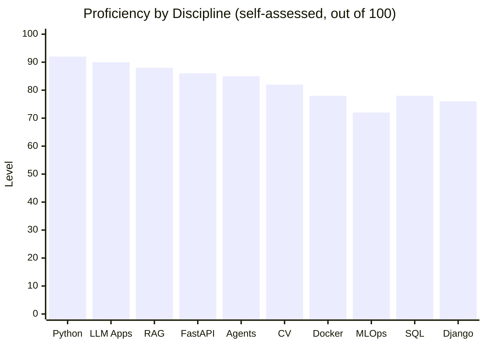

### Portfolio composition by domain (12 shipped projects)

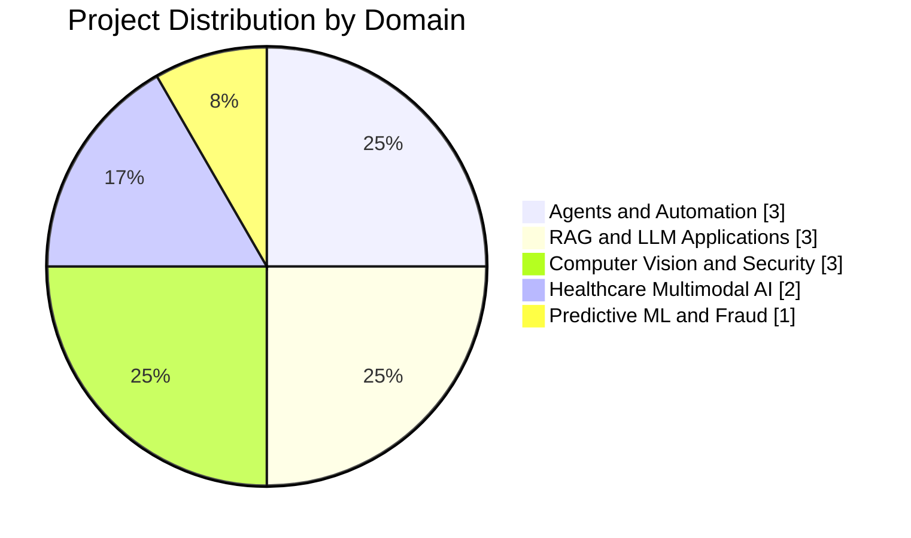

### Primary toolchain share

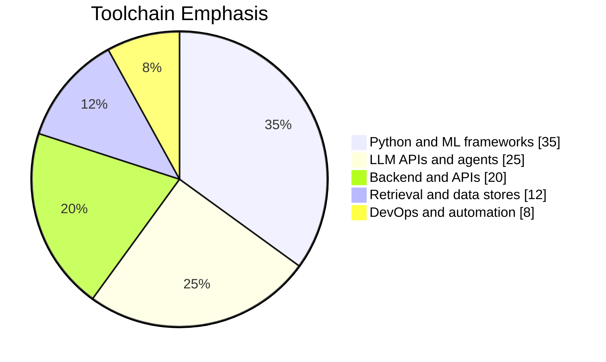

> The three charts above are my own estimates, intended to show emphasis rather than a formal benchmark.

---

## Flagship Systems: Technical Deep Dives

### 1. HealMatrix AI: multimodal, crisis-gated mental health assistant

**Final-year project.** Fuses four signal channels into a single reasoning pipeline with a safety gate ahead of generation.

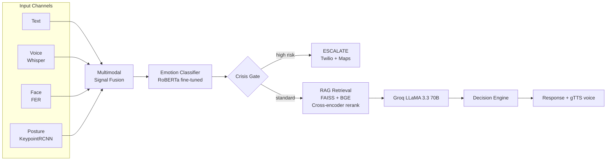

| Decision class | Intent |
|---|---|
| `ESCALATE` | Immediate crisis response and external contact pathway |
| `REASSURE` | Calming, stabilising response |
| `GUIDE` | Structured coping guidance |
| `REFER_THERAPIST` | Referral with location support |
| `MOTIVATE` | Encouragement-oriented response |
| `ASSESS` | Further questioning before committing to an action |

**Stack:** PyTorch, FER, KeypointRCNN, RoBERTa, FAISS, BGE embeddings, cross-encoder reranking, Groq LLaMA 3.3 70B, Groq Whisper, gTTS, Twilio, Google Maps API, FastAPI, Docker.
**Repository:** [Heal-Matrix-AI](https://github.com/abdullahmran-101/Heal-Matrix-AI)

---

### 2. Cheatify: real-time AI exam proctoring

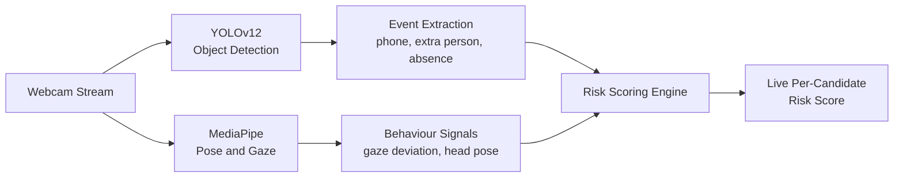

Combines object detection with pose and gaze estimation to produce a continuously updated risk score per candidate.
**Repository:** [Cheatify-AI-Proctoring-System](https://github.com/abdullahmran-101/Cheatify-AI-Proctoring-System)

---

### 3. Research Forge AI: self-hosted research-to-report pipeline

A five-stage asynchronous pipeline that converts a question into a citation-backed report, with no dependence on a hosted search API.

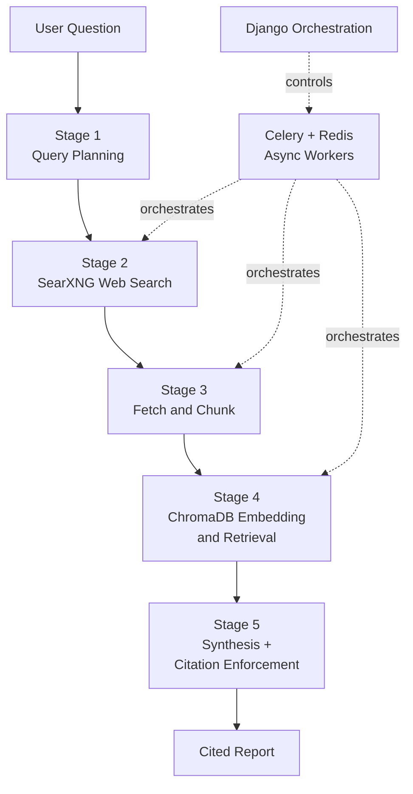

**Stack:** SearXNG, ChromaDB, Celery, Redis, Django, Docker.
**Repository:** [Research-Forge-AI](https://github.com/abdullahmran-101/Research-Forge-AI)

---

### 4. AgentFlow AI: multi-agent platform with inspectable reasoning

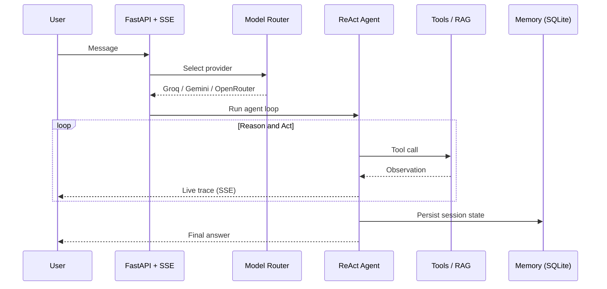

Key capabilities: ReAct reasoning loop, persistent memory, provider routing with failover, document RAG without an external vector database, and a usage analytics dashboard.
**Repository:** [Agentflow-AI](https://github.com/abdullahmran-101/Agentflow-AI)

---

### 5. Hospital Procurement and Inventory Intelligence Platform (in progress)

An AI-driven procurement system that turns raw inventory data into approved purchase orders.

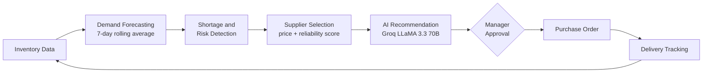

| Version | Scope | Status |
|---|---|---|
| **V1** | FastAPI backend, Postgres schema, n8n workflows for shortage detection, AI recommendation, PO creation and approval, HTTP retry logic, error-notifier workflow | Complete |
| **V2** | Demand forecasting (`usage_logs`, rolling average endpoints), weighted supplier reliability scoring from on-time rate and price competitiveness, composite supplier selection, weekly scoring workflow | Complete |
| **V3 to V5** | Document automation, multi-agent layer, Next.js dashboard, RBAC, multi-tenancy, monitoring, production SaaS hardening | Planned |

**Planned stack:** n8n, FastAPI, PostgreSQL, Redis, pgvector, Next.js, Docker.

---

## Implementation Patterns

Representative patterns from my codebase style (simplified for illustration).

**Provider routing with failover**

```python
MODEL_REGISTRY = {
    "fast":      [("groq", "llama-3.3-70b-versatile"), ("gemini", "gemini-flash")],
    "reasoning": [("gemini", "gemini-pro"), ("openrouter", "auto")],
}

async def route(task: str, messages: list[dict]) -> str:
    for provider, model in MODEL_REGISTRY[task]:
        try:
            return await PROVIDERS[provider].complete(model, messages, timeout=20)
        except (RateLimitError, TimeoutError):
            continue                      # fail over to the next provider
    raise ServiceUnavailable("all providers exhausted")
```

**Safety gate ahead of generation**

```python
def respond(signal: FusedSignal, query: str) -> Response:
    risk = crisis_score(signal)                 # fused text, face, voice, posture
    if risk >= CRISIS_THRESHOLD:
        return escalate(signal)                 # bypass generation entirely
    context = reranker.rank(query, retriever.search(query, k=20))[:5]
    return decide(llm.generate(query, context), signal)
```

**Streaming agent trace over SSE**

```python
@app.get("/chat/stream")
async def stream(session_id: str, q: str):
    async def events():
        async for step in agent.astream({"input": q}, session=session_id):
            yield f"event: {step.kind}\ndata: {step.json()}\n\n"   # thought, tool, observation
    return StreamingResponse(events(), media_type="text/event-stream")
```

---

## Reference Architecture

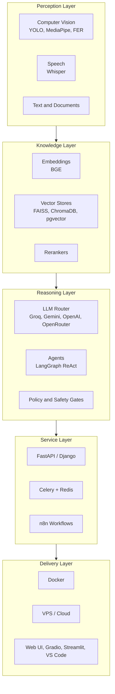

---

## Complete Project Catalogue

| Project | Domain | Description | Key technologies |
|---|---|---|---|
| **HealMatrix AI** | Healthcare, multimodal | Crisis-gated mental health assistant fusing text, voice, face and posture | LLaMA 3.3 70B, FAISS, RoBERTa, FastAPI |
| **VITA** | Healthcare, multimodal | Clinical decision support from speech and visual symptom input | Transformer fusion, ElevenLabs |
| **Cheatify** | Computer vision | Exam proctoring with live per-candidate risk score | YOLOv12, MediaPipe |
| **IntelliFall AI** | CV and IoT | Fall detection system | CV, IoT |
| **MalVision AI** | Security, XAI | Explainable malware detection and threat intelligence dashboard | Streamlit, explainability |
| **Research Forge AI** | RAG, research | Question to citation-backed report, fully self-hosted | SearXNG, ChromaDB, Celery |
| **AgentFlow AI** | Agents | Multi-provider ReAct platform with live trace and memory | LangGraph, SSE, SQLite |
| **Pocho AI** | RAG | Admissions FAQ assistant grounded in retrieved documents | Django, TF-IDF, Grok |
| **QuickByte AI** | LLM application | Nutrition-focused LLM platform | LLM APIs |
| **WhatsAgent AI** | Automation | Autonomous WhatsApp customer support agent | n8n, Twilio, Airtable |
| **Quantifier AI** | Automation | Lead scoring (0 to 100) with HOT, WARM, COLD tiers | n8n, GPT, Sheets, Gmail |
| **FraudShield AI** | Predictive ML | Fraud detection | scikit-learn |

---

## Active Development

```diff
+ Hospital Procurement Intelligence Platform     V2 complete, V3 in planning
+ AI Coding Assistant                            VS Code extension + FastAPI multi-LLM router (Phase 2 of 10 complete)
+ Lahori                                         Lahore food discovery platform
```

**AI Coding Assistant architecture**

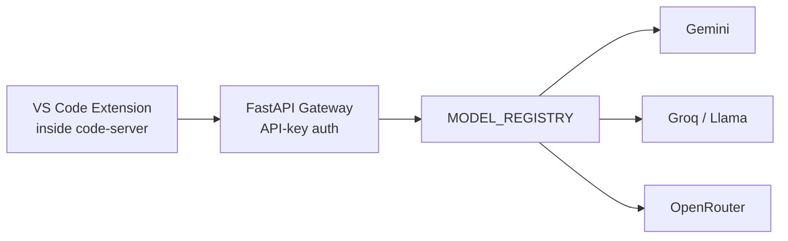

---

## Professional Timeline

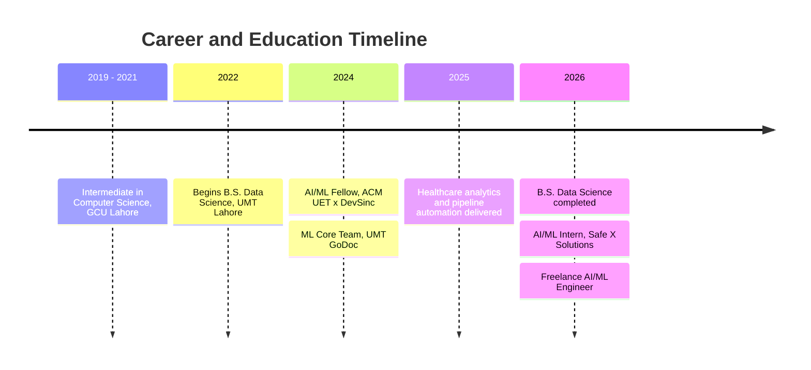

### Experience

| Role | Organisation | Period | Contribution |
|---|---|---|---|
| **Associate AI/ML Engineer** | Self-employed, Remote | Oct 2026 to Present | End-to-end LLM applications, RAG pipelines, AI agents, backend APIs, automation |
| **Junior Machine Learning Engineer** | Sunsprinkle, Remote | Dec 2025 to Oct 2026 | Developed Python-based ML models, optimized predictive analytics workflows, and integrated AI/ML solutions into backend applications. |
| **AI/ML Fellow** | ACM UET x DevSinc | Jul 2024 to Feb 2025 | Healthcare predictive analytics with a **90% accuracy** body-fat prediction model; automated ML pipeline delivering **30% faster** processing |
| **ML Core Team Member** | UMT GoDoc | Oct 2024 to Nov 2025 | Data preprocessing, predictive modelling, ML workflow implementation |

---

## Education and Certifications

**University of Management and Technology (UMT), Lahore**
B.S. in Data Science, Oct 2022 to Jun 2026. GPA **3.76 / 4.00**. Dean's Merit Award, four times.

**Government College University (GCU), Lahore**
Intermediate of Computer Science, Aug 2019 to Apr 2021.

| Certification | Issuer |
|---|---|
| Deep Learning Specialization | DeepLearning.AI (Coursera) |
| Generative AI Engineering with LLMs Specialization | IBM (Coursera) |
| IBM Data Science Professional Certificate | IBM (Coursera) |
| Google Data Analytics Professional Certificate | Google (Coursera) |
| AI Engineer for Data Scientists Associate | DataCamp |
| Data Scientist Certification | DataCamp |

---

## Research and Technology Directions

| Direction | Focus |
|---|---|
| **Agentic AI** | Multi-agent orchestration, tool use, persistent memory, observable reasoning traces |
| **Multimodal reasoning** | Fusing vision, speech and language into a single decision pipeline |
| **Clinical and healthcare AI** | Decision support, triage, mental-health assistance with safety constraints |
| **Explainable and trustworthy AI** | Interpretable detection, citation-grounded generation, auditable decisions |
| **Edge AI and IoT** | Real-time inference for monitoring and detection scenarios |
| **Production MLOps** | Containerised, monitored, multi-tenant AI services |
| **Enterprise automation** | LLM-driven workflows for procurement, support and lead operations |

<br/>

<h1 align="center">"THE MODEL IS THE EASY PART. THE SYSTEM AROUND IT IS THE PRODUCT."</h1>

<br/>

---

## GitHub Analytics

<div align="center">


<br/>


<br/>


<br/>


<br/>


</div>

---

## Engagement Models

| Engagement | Scope | Typical deliverable |
|---|---|---|
| **Full-time role** | AI/ML engineering, applied GenAI, backend intelligence | Production services and models |
| **Contract build** | RAG systems, agents, LLM applications, computer vision pipelines | Deployed, documented system |
| **Automation** | n8n and Zapier workflows with LLM decision steps | Resilient workflow with error handling |
| **Prototype to production** | Taking a notebook or demo to an API and container | FastAPI service with Docker deployment |

---

## Contact

| Channel | Details |
|---|---|
| **Email** | abdullahmran.001@gmail.com |
| **Phone** | +92 316 400 9363 |
| **LinkedIn** | [linkedin.com/in/abdullah-imran-211658230](https://www.linkedin.com/in/abdullah-imran-211658230) |
| **GitHub** | [github.com/abdullahmran-101](https://github.com/abdullahmran-101) |
| **Location** | Lahore, Pakistan (open to remote) |

<br/>

<h1 align="center">"SHIP IT. MEASURE IT. MAKE IT BETTER."</h1>


