<!-- Generated by scripts/render_readme_cards.py (theme: pro). Re-run it to change the theme:
     python scripts/render_readme_cards.py pro | ember | matcha
     Keep cards in a row on one line with no spaces between them. -->

 
 
 
 
 
 
 
 
 

 
 

 
 
 
 
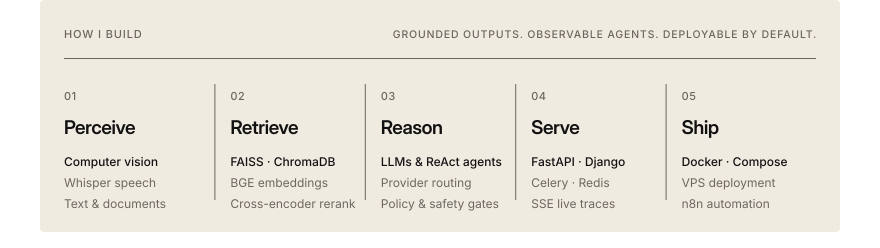 
 
 
 
 
 
  
 
 
 
<a href="https://github.com/abdullahmran-101/Cheatify-AI-Proctoring-System"></a> 
<a href="https://github.com/abdullahmran-101/Agentflow-AI"></a> 

 
 

 
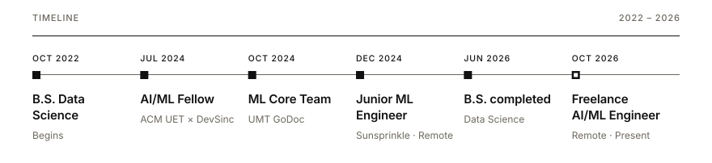 

 
 

 
 
 
 

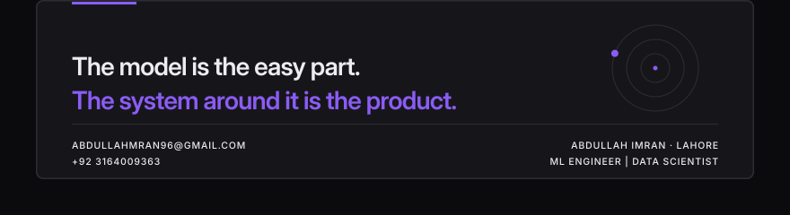

