<!-- Every card is an animated SVG drawn by scripts/render_readme_cards.py and refreshed daily
     by .github/workflows/update-profile-art.yml. Palette: black, white, grey only.
     Spacing is baked into the SVGs, so keep cards in a row on one line with no spaces between them. -->

 
 
 
 
 
 
 
 
 
 
 
 
 

