<!-- Every card is an animated SVG drawn by scripts/render_readme_cards.py and refreshed daily
     by .github/workflows/update-profile-art.yml. Palette: deep navy base with cyan, violet, pink, amber, green.
     Spacing is baked into the SVGs, so keep cards in a row on one line with no spaces between them. -->

 
 
 
 
 
 
 
 
 
 
 
 
 
 
 
  
 
 
 
 
 
 
 
 
 
 
 
 
 

